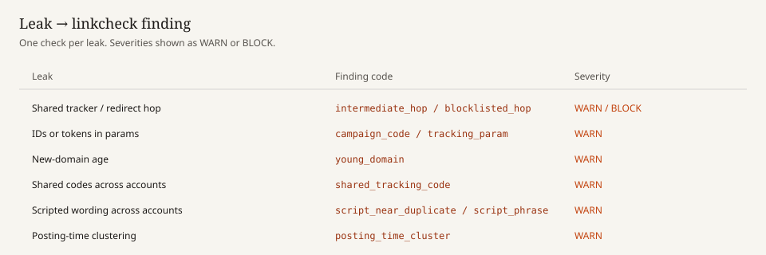

# linkcheck

A check you run on a draft **before it is posted**. It follows every link and
reads the wording, then says whether that draft would let outsiders tie your
post to other accounts.

## Why this exists

Paid campaigns often hand creators a short link that looks ordinary. Behind it,
clicks quietly bounce through a **shared redirect/tracker domain** that embeds
**creator and campaign IDs**. When many accounts also reuse **near-identical
scripted wording** in a **short window after a public policy event**, outside
researchers can rebuild the whole network from public redirects alone—and when
operators swap to a **freshly registered** hop host, that young domain is
another fingerprint.

`linkcheck` exists so you can catch those join keys in the draft, not after
someone else maps your account into a graph. Full anonymised case study:
[docs/PROBLEM.md](docs/PROBLEM.md).

## The problem

In an anonymised public-style investigation (placeholders only: `Creator A`,
`Agency X`, `track.example`, `short.example/abc`):

1. An operator paid **dozens of creators** (millions of combined followers) to
   push a contentious policy narrative.
2. Short links detoured through one shared tracker that stamped opaque codes.
3. Many posts used the same scripted sentence within about two weeks of the
   announcement.
4. Researchers followed hops, decoded shared IDs, and grouped the accounts
   across **thousands of posts** and **over a thousand campaigns**.
5. After contact, the operator stood up a new redirect domain in **about an
   hour**—also spotted.

Diagrams and the “what leaked” table: [docs/PROBLEM.md](docs/PROBLEM.md).

```
short.example/abc  →  track.example/?utm_campaign=<shared code>  →  news.example/story
```


## What linkcheck checks

Each leak from the case study maps to one check:

| Leak (see [PROBLEM.md](docs/PROBLEM.md)) | Check | Finding code | Result |
| --- | --- | --- | --- |
| Shared tracker / redirect hop | Intermediate hop that is not a known shortener or destination; optional hard blocklist | `intermediate_hop`, `blocklisted_hop` | **WARN** / **BLOCK** |
| IDs or tokens in params | Identifying keys (`cid`, `creator`, `campaign`, …) and opaque tokens (e.g. 8-hex in `utm_campaign`) | `tracking_param`, `tracking_token`, `campaign_code` | **WARN** |
| New-domain age | Hop domain younger than about 90 days | `young_domain` | **WARN** |
| Shared codes across accounts | Same tracking code on 3+ other accounts in the corpus (14-day lookback) | `shared_tracking_code` | **WARN** |
| Scripted wording across accounts | Near-duplicate text vs corpus, or a known phrase list hit | `script_near_duplicate`, `script_phrase` | **WARN** |
| Posting-time clustering | Matched similar posts bunched inside a short time window | `posting_time_cluster` | **WARN** |
| (Remedy) | Suggested destination with tracking keys stripped | `clean_url_suggestion` | **INFO** |

Ordinary word-like `utm_*` values (for example `utm_medium=cpc`) are **INFO**
only (`utm_params`).



## Documentation

| Doc | What it is |
| --- | --- |
| [docs/guide.md](docs/guide.md) | Install, flags, reading reports, config overview |
| [docs/examples.md](docs/examples.md) | OK / WARN / BLOCK worked examples |
| [docs/PROBLEM.md](docs/PROBLEM.md) | Anonymised case study and leak table (`problem.md` redirects here) |
| [docs/schema.md](docs/schema.md) | `--json` fields for a bot |
| [AGENTS.md](AGENTS.md) / [SKILL.md](SKILL.md) | Short agent contracts |

## Point this repo at your bot

Copy-paste this to your bot:

> This repo is linkcheck. From the checkout, install it with `pip install -e .`. When I say "check my links in my twitter drafts before I post", run `linkcheck --json --text "<draft>"` on each draft and do not post it yourself. If the verdict is BLOCK, show me the reasons and stop. If WARN, show me the reasons and the suggested clean link, and wait until I explicitly say to post. If OK, tell me it is clear. Follow AGENTS.md and SKILL.md.

## Install

From a checkout of this repo:

```bash
pip install -e ".[dev]"
```

With credentials that can read the private repo:

```bash
pip install "git+https://github.com/chriscoveries/linkcheck.git"
```

## Usage

```bash
linkcheck --text "A note https://news.example/story?utm_campaign=a1b2c3d4"
linkcheck --json --text "Draft with https://short.example/ab12"
printf '%s' "draft text" | linkcheck --stdin
```

Exit codes: `0` clear, `1` warn, `2` block. Worked output: [docs/examples.md](docs/examples.md). JSON: [docs/schema.md](docs/schema.md).

### Files you edit

- `data/blocklist.txt` — hosts that must never appear in a hop (ships empty)
- `data/allowlist.txt` — your own sites
- `data/shorteners.txt` — hosts that only shorten links
- `data/phrases.txt` — shared lines you already know
- `data/corpus.jsonl` — recent posts by other accounts, so shared codes, wording, and timing clusters can be seen

### Already-posted check

```bash
export X_BEARER_TOKEN=...
linkcheck --json monitor --user-id <id>
```

## Tests

```bash
pytest -q
```

## Limitations

tracing needs the network; age lookups can soft-fail; wording/timing checks need a corpus; the clean link only strips known keys; the blocklist ships empty.

## License

MIT
