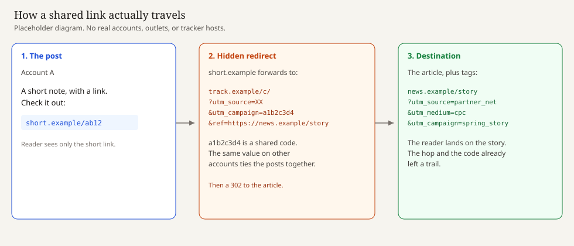

# linkcheck

This repo is for an agent. A person is not expected to read it or run it.

**Check the draft before you post. Scan every link the account already put up. Catch the codes that glue accounts together.**

A short link can hop through a tracker that stamps the same campaign code on many accounts. Same wording makes the group obvious. linkcheck is the bot-side gate: draft check, X MCP loop, and full-history link scan — OK / WARN / BLOCK.

The pictures in [docs/problem.md](docs/problem.md) use only placeholder hosts (`short.example`, `track.example`, `news.example`) and unnamed accounts.

## Point this repo at your bot

Copy-paste this to your bot:

> This repo is linkcheck. You operate it; I will not read it. Install with `pip install -e .`, then `linkcheck runtime --json`. Before any post: check-draft (`linkcheck --json --no-age --file <draft>`). Exit 2 stop, exit 1 show reasons and wait, exit 0 clear. If you have X MCP (`namespace: x`), use x-plan → save tool output to a file → x-ingest. For a full history of this account's link posts: `x-plan all-posts --username <me> --state state.json` and loop until `done`.

## What it does

| Job | How |
| --- | --- |
| Pre-publish draft check | Hops, trackers, shared codes, scripted wording |
| X MCP loop | Deterministic `x-plan` → CallDynamicTool → `x-ingest` |
| Own / all link posts | `from:user has:links` only — ~1 read per 25 link posts |
| Full-history scan | Resumable `all-posts` with `next_token`, incremental `since_id` |
| Bearer fallback | `monitor` when MCP is unavailable |

## How the leak happens

1. A draft contains only a short link.
2. That short link 302s through a hidden hop on some other host.
3. The hop URL carries ID codes reused across many accounts.
4. Anyone who traces redirects can group the posts. Near-identical wording seals it.
5. A new intermediate domain can replace a burned tracker host overnight.

```
short link  →  hidden hop ?utm_campaign=<shared code>  →  article
```




## What linkcheck checks


| Check | Result |
| --- | --- |
| A hop host is on your blocklist | **BLOCK** |
| An intermediate hop is neither a known shortener nor the destination | **WARN** |
| Identifying query params (`cid`, `ref`, `fbclid`, `si`, …) or opaque tokens | **WARN** |
| An opaque code hiding in `utm_*` | **WARN** |
| Ordinary word-like `utm_*` values | **INFO** |
| A hop domain younger than about 90 days | **WARN** |
| Near-duplicate wording, shared phrase, or same code on 3+ accounts | **WARN** |
| Final hop HTTP 401/404 | **INFO** `dead_link` |
| A clean link with tracking keys removed | **INFO** (suggestion) |

## Documentation

| Doc | What it is |
| --- | --- |
| [docs/guide.md](docs/guide.md) | Install, flags, reports, corpus |
| [docs/examples.md](docs/examples.md) | OK / WARN / BLOCK runs |
| [docs/problem.md](docs/problem.md) | Why a short link can group accounts |
| [docs/schema.md](docs/schema.md) | `--json` fields |
| [AGENTS.md](AGENTS.md) | Bot runtime + x-loop + read math |
| [SKILL.md](SKILL.md) | Same rules as a skill file |

## Install

```bash
pip install -e ".[dev]"
```

```bash
pip install "git+https://github.com/chriscoveries/linkcheck.git"
```

## Usage

```bash
linkcheck --json --no-age --file draft.txt
linkcheck x-plan own-posts --username me --json
linkcheck x-plan all-posts --username me --state state.json --json
linkcheck x-ingest --file page.json --append state.json --json
```

Exit codes: `0` clear, `1` warn, `2` block.

## Tests

```bash
pytest -q
```

## License

MIT
