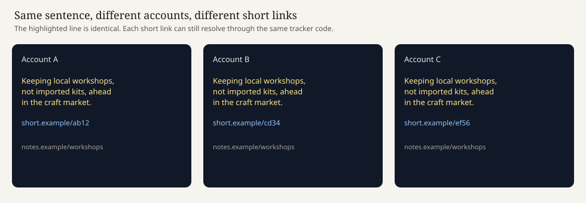
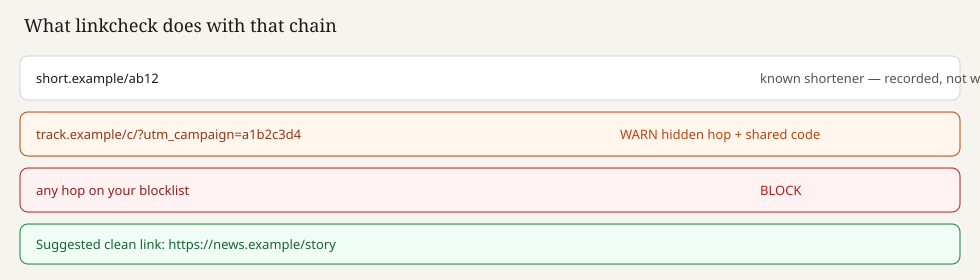

# linkcheck

This repo is for an agent. A person is not expected to read it or run it.

The agent starts with `AGENTS.md`, then `linkcheck runtime --json`, then the playbook for the job. The account's own draft is checked before anything is posted (`playbooks/check-draft.md`). Posts already up are a separate playbook, and only when a bearer token is already set.

A short link can pass through a hidden hop that adds a code shared with other accounts. linkcheck follows the hops and reports OK, WARN, or BLOCK.

Shortened links often pass through hidden redirect hops that attach tracking codes. When many accounts post links carrying the same tracker domain or campaign/creator codes, or the same scripted wording, outsiders can follow those hops and link the accounts together, exposing a coordinated network and the people in it. linkcheck inspects every link and draft before posting so that common, linkable info does not leak.

The pictures in [docs/problem.md](docs/problem.md) use only placeholder hosts (`short.example`, `track.example`, `news.example`) and unnamed accounts. They are not copies of anyone's posts.

## Point this repo at your bot

Copy-paste this to your bot:

> This repo is linkcheck. You operate it; I will not read it. Install with `pip install -e .`, then run `linkcheck runtime --json` and follow the playbooks. Before you post anything for me, run the check-draft playbook on my draft (`linkcheck --json --no-age --file <draft>`). Exit 2: do not post. Exit 1: show me the reasons and wait. Exit 0: clear. If a token is already set, the check-own-posts playbook can review what I already posted.

## How the leak happens

1. A draft contains only a short link.
2. That short link does not open the article. It 302s through a hidden hop on some other host.
3. The hop URL carries ID codes (creator, campaign, click, or an opaque token such as eight hex characters). The same code is reused across many accounts.
4. The reader lands on the article. The hop and the codes are already in the chain, so anyone who traces redirects can group the posts. Near-identical wording makes the group obvious.
5. When one tracker host is noticed, a new host can be registered and pointed at the same way, with the same code shape. A very new intermediate domain is a signal by itself.

```
short link  →  hidden hop ?utm_campaign=<shared code>  →  article
```




## What linkcheck checks



| Check | Result |
| --- | --- |
| A hop host is on your blocklist | **BLOCK** |
| An intermediate hop is neither a known shortener nor the destination | **WARN** |
| Identifying query params (`cid`, `creator`, `campaign`, `aff`, `subid`, `clickid`, …) or opaque tokens | **WARN** |
| An opaque code hiding in `utm_*` (for example 8 hex characters) | **WARN** |
| Ordinary word-like `utm_*` values | **INFO** |
| A hop domain younger than about 90 days (lookup fails soft) | **WARN** |
| Near-duplicate wording, a known shared phrase, or the same code on 3+ other accounts in 14 days | **WARN** |
| A clean link with those tracking keys removed | **INFO** (suggestion) |

## Documentation

| Doc | What it is |
| --- | --- |
| [docs/guide.md](docs/guide.md) | Install, every flag, how to read a report, config files, corpus, clean links, already-posted checks |
| [docs/examples.md](docs/examples.md) | OK, WARN, and BLOCK runs with the output |
| [docs/problem.md](docs/problem.md) | Why a short link can group accounts, with placeholder figures |
| [docs/schema.md](docs/schema.md) | `--json` fields for a bot |
| [AGENTS.md](AGENTS.md) | Instructions for any bot that can run a shell command |
| [SKILL.md](SKILL.md) | Same rules, as a skill file |

## Install

From a checkout of this repo:

```bash
pip install -e ".[dev]"
```

With credentials that can read the private repo:

```bash
pip install "git+https://github.com/chriscoveries/linkcheck.git"
```

## Usage

```bash
linkcheck --text "A note https://news.example/story?utm_campaign=a1b2c3d4"
linkcheck --json --text "Draft with https://short.example/ab12"
printf '%s' "draft text" | linkcheck --stdin
```

Exit codes: `0` clear, `1` warn, `2` block. JSON shape: [docs/schema.md](docs/schema.md).

### Files you edit

- `data/blocklist.txt` — hosts that must never appear in a hop (ships empty)
- `data/allowlist.txt` — your own sites
- `data/shorteners.txt` — hosts that only shorten links
- `data/phrases.txt` — shared lines you already know
- `data/corpus.jsonl` — recent posts by other accounts, so shared codes and wording can be seen

### Already-posted check

```bash
export X_BEARER_TOKEN=...
linkcheck monitor --user-id <id> --json
```

## Tests

```bash
pytest -q
```

## Limitations

- Tracing needs the network. Some hops only run in a browser.
- Age lookups sometimes have no public answer. That is reported, not treated as a failure.
- Shared-wording checks only see the corpus you give them.
- The clean link drops known tracking keys. It does not prove the page is the one you meant.
- The blocklist starts empty. Add tracker hosts you want to hard-fail.

## License

MIT
