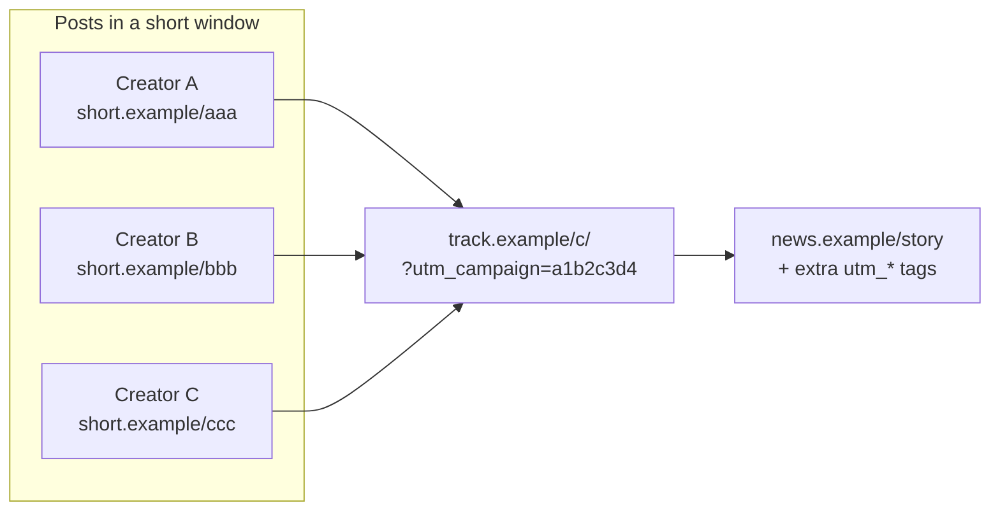
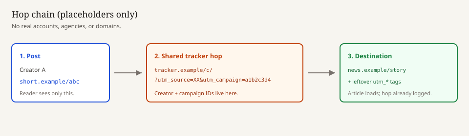
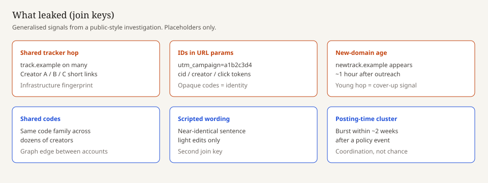
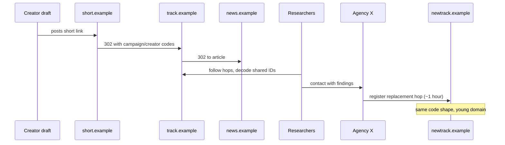
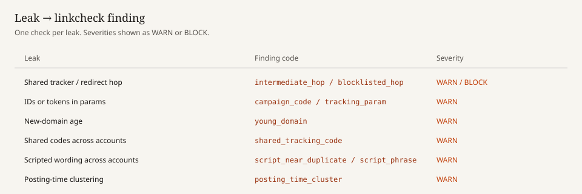

# Case study: how shared links expose a coordinated network

This note explains the real-world failure mode that `linkcheck` is built to catch.
Names, brands, people, outlets, and real domains from any public investigation are
replaced with placeholders (`Creator A`, `Agency X`, `track.example`,
`short.example/abc`). Counts are generalised so the pattern stays clear without
identifying a specific campaign.

## Why this exists

People who post links often paste a short URL that looks harmless. Behind that
short link, a paid campaign can silently bounce the click through a shared
redirect or tracker host that stamps creator and campaign IDs into the URL. When
dozens of creators reuse the same hop host, the same opaque codes, and near-identical
scripted wording in a short window after a policy event, outside researchers can
rebuild the whole network from public redirects alone. `linkcheck` is a
pre-publish check so a draft does not carry those join keys.

## The anonymised case

### Setup

- A marketing operator (**Agency X**) ran **over a thousand** paid campaigns for
  many clients.
- For one push, **dozens of creators** with **millions of combined followers**
  were paid to promote a contentious product policy: an administration had just
  approved high-tech exports that some lawmakers opposed.
- Creators were given short links (`short.example/...`). Each short link looked
  unique in the post. Readers never saw the intermediate host.

### What the posts looked like

Within about **two weeks** after the policy announcement, many accounts posted
variations of the same script: praise for the decision, a claim that domestic
(not foreign) components would keep leading a strategic market, and a short link
to an article. The wording was close enough that a highlighter across several
timelines showed one shared sentence with only light edits.

### How researchers followed the hops

1. Expand each short link.
2. Observe that most links **did not** go straight to the article. They took a
   brief detour through **`track.example`**, a shared redirect/tracker domain.
3. Read the query string on that hop: platform tags plus an opaque
   **`utm_campaign`** (and similar) value that encoded **creator and campaign
   identity**.
4. Group every account whose links shared that host and those code shapes.
5. Cross-check **near-identical wording** and **posting times** clustered after
   the policy event.
6. Attribute the shared infrastructure to **Agency X**. Dataset scale reported
   publicly was on the order of **thousands of posts** across **over a thousand
   campaigns**.

### Operator response

When researchers contacted the operator with findings, a **freshly registered
redirect domain** appeared within **about an hour**. By the next day, new creator
links were routing through the replacement host with the same code shape. The
swap itself became another signal: a very young intermediate domain carrying the
same opaque IDs.

## What leaked (join keys)

| Leak | What outsiders saw | Why it grouped accounts |
| --- | --- | --- |
| Shared tracker / redirect hop | Many short links bounced through `track.example` before the article | One host tied dozens of creators to one operator |
| IDs / tokens in URL params | Opaque values such as `utm_campaign=a1b2c3d4`, `cid=…` on the hop or destination | Same code family reappeared across accounts and campaigns |
| New-domain age | After outreach, `newtrack.example` appeared within about an hour | A brand-new intermediate host with the old code shape confirmed a cover-up swap |
| Shared codes across accounts | Identical or patterned campaign/creator codes in many posts | Codes became a graph edge between accounts |
| Scripted wording across accounts | Near-identical sentences in a short window after the policy event | Wording was a second join key even when short links differed |
| Posting-time clustering | Dozens of related posts landed within about two weeks of the announcement | Timing showed coordination, not organic coincidence |

## Lessons

1. **The visible short link is not the whole story.** Always expand redirects.
2. **Shared intermediate hosts are infrastructure fingerprints.** Block or warn
   on unknown hops that are neither a known shortener nor the destination.
3. **Opaque codes in `utm_*` or `cid`-style params are identity**, not harmless
   analytics labels, when they recur across accounts.
4. **A newly registered redirect domain is a signal**, especially right after a
   tracker is exposed.
5. **Wording + timing multiply certainty.** Matching scripts in a tight window
   after a public event make the network obvious even without perfect URL codes.
6. **Stripping tracking before publish** (and avoiding agency-supplied tracked
   shorts) removes the cheapest join keys.

## What `linkcheck` does with this

See the README section **What linkcheck checks** for a one-to-one map from each
leak above to a concrete check and severity. Run the tool on the exact draft
text before posting; do not treat a clean-looking short link as safe until the
hop chain and wording checks pass.
