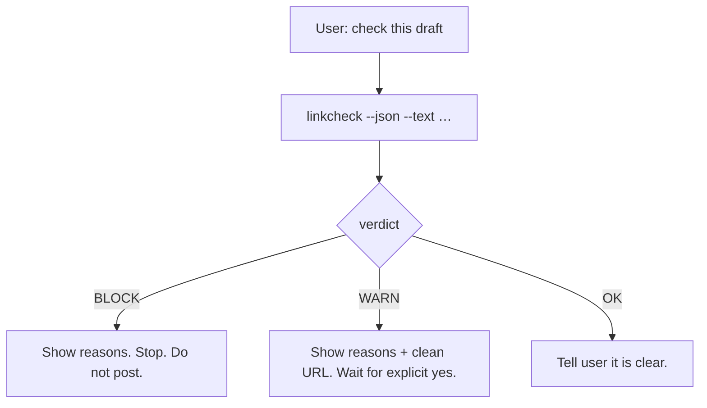

# Pointing an agent at this repo

Short contracts: [AGENTS.md](../AGENTS.md), [SKILL.md](../SKILL.md). The guide
also has a one-block prompt under “Point a bot at this repo”. This page covers
several agent products and the BLOCK/WARN/OK flow.



| Verdict | Exit | Agent behaviour |
| --- | --- | --- |
| `BLOCK` | 2 | Do not post. Show every reason. Stop. |
| `WARN` | 1 | Do not post. Explain reasons. Offer `urls[].clean`. Wait for an explicit yes. |
| `OK` | 0 | Say the draft is clear. INFO optional. |

Never silently rewrite a link. Never invent a post. Prefer `--file` or an API
call so untrusted draft text is not interpolated into a shell string.

## Install

```bash
pip install -e .
```

## Copy-paste: Grok Bot / custom bot

> This repo is linkcheck. Install with `pip install -e .` from the checkout (or `pip install "git+https://github.com/chriscoveries/linkcheck.git"` with read credentials). When I say "check my links in my twitter drafts before I post", run `linkcheck --json --text "<draft>"` on each draft and do not post it yourself. If BLOCK, show reasons and stop. If WARN, show reasons and the suggested clean link, and wait until I explicitly say to post. If OK, tell me it is clear. Follow AGENTS.md and SKILL.md. Background: docs/PROBLEM.md.

## Copy-paste: Cursor

> Follow AGENTS.md in this repo. For every draft I paste, run `linkcheck --json --text "<draft>"` (or `--file`). Obey BLOCK/WARN/OK. Do not post. See docs/agents.md and docs/PROBLEM.md.

## Copy-paste: Claude Code

> Read AGENTS.md and SKILL.md. When I ask to check a draft, run `linkcheck --json --text "…"`. Never publish. Use `--no-age` only if I say we are offline.

## Copy-paste: Codex / other CLI agents

> Before any social post containing a URL, run `linkcheck --json --text "<full draft>"`. Exit 2 ⇒ refuse. Exit 1 ⇒ report and wait. Exit 0 ⇒ clear. See docs/cli.md and docs/schema.md.

## JSON fields to read

`verdict`, `exit_code`, `reasons[]`, `urls[].clean`, `urls[].hops` — [schema.md](schema.md).
