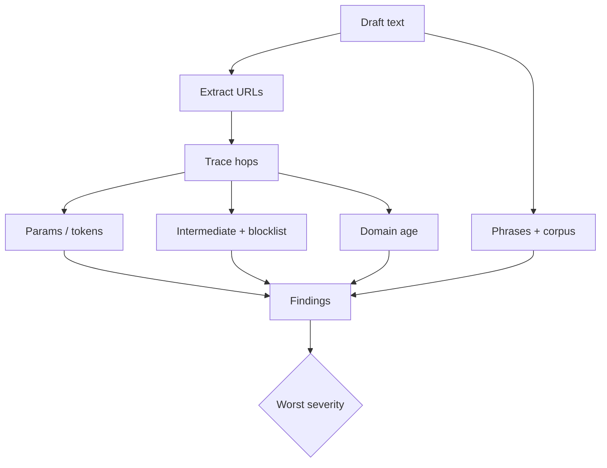

# How each check works

Summary tables live in [guide.md](guide.md#what-each-code-means). This page is
the deep dive: why the signal exists, thresholds, and false positives. Story
context: [PROBLEM.md](PROBLEM.md).



## Shared tracker / redirect hop

**Codes:** `intermediate_hop` (WARN), `blocklisted_hop` (BLOCK)

After tracing, any hop that is not a known shortener, not the destination, and
not allowlisted is an unexpected intermediate—the usual shape of a shared
tracker (`track.example`). Put hosts you never want on `data/blocklist.txt` to
raise BLOCK even when DNS fails.

**False positives.** CDN or A/B hops. Allowlist first-party hosts; keep shorteners
listed so ordinary `bit.ly` / `t.co` hops stay quiet.

**Tests:** `tests/test_redirect_blocklist.py`, `tests/test_leaks.py`.

## IDs or tokens in params

**Codes:** `tracking_param`, `tracking_token`, `campaign_code` (WARN);
`utm_params` (INFO)

Identifying keys (`cid`, `creator`, `campaign`, `aff`, `clickid`, …) warn.
Opaque `utm_*` values (8-hex or long tokens) warn as `campaign_code`. Word-like
UTMs stay INFO.

```bash
linkcheck --no-age --text "See https://news.example/a?cid=creator99"
linkcheck --no-age --text "A note https://news.example/story?utm_campaign=a1b2c3d4"
```

**False positives.** Human-readable `utm_campaign=spring` is INFO, not WARN.

## New-domain age

**Codes:** `young_domain` (WARN), `domain_age_unknown` (INFO)

RDAP via `rdap.org` (optional WHOIS fallback). Threshold: **90 days**. Soft-fails
to INFO. Disable with `--no-age`.

**Why.** After exposure, operators often register a replacement hop within about
an hour ([PROBLEM.md](PROBLEM.md)).

## Shared codes across accounts

**Code:** `shared_tracking_code` (WARN)

Needs a corpus. Same key/value on **≥ 3** other accounts in the **14-day**
lookback → WARN. See [configuration.md](configuration.md#corpus-jsonl).

## Scripted wording across accounts

**Codes:** `script_near_duplicate`, `script_phrase` (WARN)

Near-duplicate: max(Jaccard shingles, TF-IDF cosine) ≥ **0.85** against **≥ 3**
accounts. Phrases: case-insensitive substring after stripping URLs/@/#.

Worked wording example: [examples.md](examples.md#same-sentence-across-accounts).

## Posting-time clustering

**Code:** `posting_time_cluster` (WARN)

When near-duplicate matches exist for ≥ 3 accounts, if their `created_at` values
(plus draft time = now) fall inside a **168-hour (7-day)** window → WARN.

**False positives.** Organic breaking-news pile-ons. Combine with codes/hops.

## Clean URL suggestion

**Code:** `clean_url_suggestion` (INFO)

Strips known tracking keys (list in [guide.md](guide.md#the-clean-link)). Never
rewrites the draft automatically.
