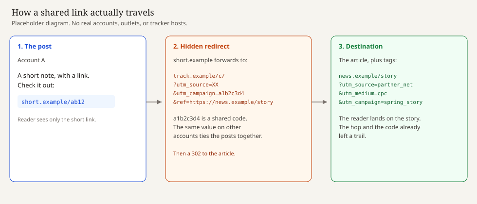
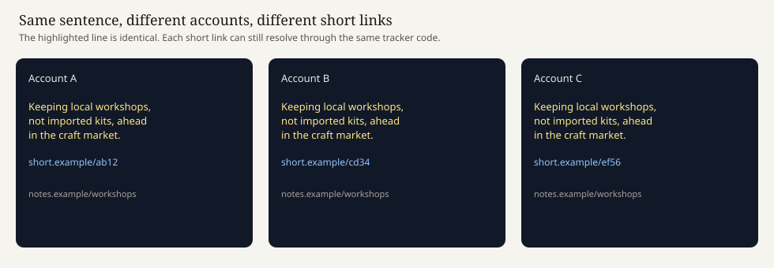
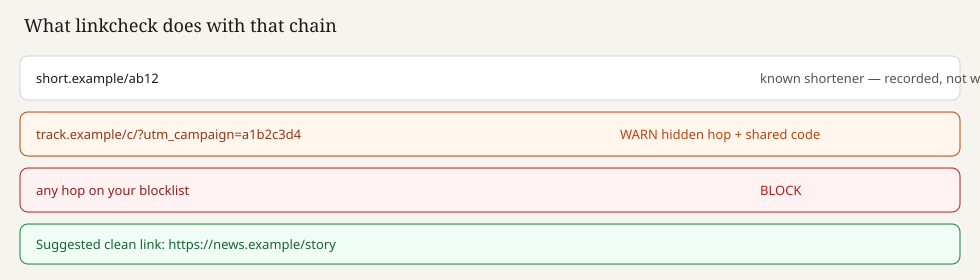

# Purpose

`linkcheck` is a pre-publish check for people who post links. It follows each link, lists every redirect hop, and flags the bits that let an outsider group one post with many others: a hidden tracker host, a shared campaign or creator code, or wording that already appears across other accounts. It then suggests the same destination with those tags removed.

It does not decide whether a post is an advertisement. It only asks whether the draft is carrying common, linkable info.

# The problem, in general terms

Shortened links often pass through hidden redirect hops that attach tracking codes. When many accounts post links carrying the same tracker domain or campaign/creator codes, or the same scripted wording, outside researchers can follow those hops and link the accounts together, exposing a coordinated network and the people in it.

The figures below are placeholders. They are not copies of anyone's posts, and they do not name accounts, outlets, or tracker hosts.

## How the leak happens

1. The draft contains only a short link, such as `short.example/ab12`.
2. That short link does not go straight to the article. A public shortener lookup shows the next hop is a different host, `track.example`, with query tags. One of those tags is an opaque code (`utm_campaign=a1b2c3d4`) that identifies the poster and the push. The same code shows up on other accounts.
3. `track.example` answers with a 302. The browser lands on `news.example/story`, now decorated with further tags (`utm_source`, `utm_medium`, `utm_campaign`, `utm_content`). The reader sees the article. The hop and the code are already in the chain.
4. After a tracker host becomes known, a replacement host can be registered and pointed the same way, with the same code shape, on a very short timeline. A young intermediate domain is itself a signal.
5. Some links skip the hidden host and still carry the opaque code on the destination URL. The code alone is enough to cluster the posts.

## Same wording makes the cluster obvious

Separate accounts post the same sentence, each with its own short link, all pointing at the same page. The sentence is a second join key. The short links are the first.

## What linkcheck checks

| What it sees | Verdict |
| --- | --- |
| A hop whose host is on your blocklist | BLOCK |
| An intermediate host that is neither a known shortener nor the destination | WARN |
| An opaque code in the query string, including an 8-hex value hiding in `utm_campaign` | WARN |
| Ordinary word-like `utm_*` values (`utm_medium=cpc`) | INFO |
| A hop domain younger than about 90 days | WARN |
| The same code, or near-identical wording, on posts by three or more other accounts in the last 14 days | WARN |
| A clean URL with those tracking keys removed | INFO (suggestion) |

The default blocklist ships empty. Add hosts you never want in a hop chain, one per line, in `data/blocklist.txt`.
